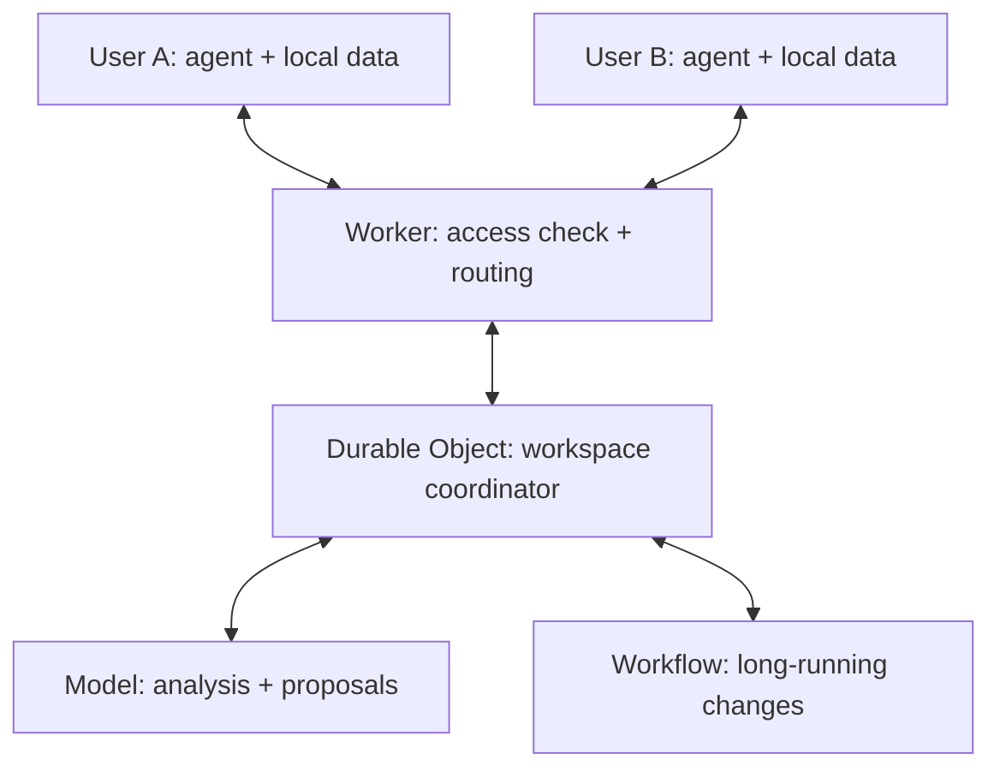

# Reference Architecture: Capability-as-Infrastructure on Cloudflare

**Companion to:** [Capability-as-Infrastructure: Software on Demand](capability-as-infrastructure.md)
**Author:** Michael Shatny ([ORCID: 0009-0006-2011-3258](https://orcid.org/0009-0006-2011-3258))
**Status:** Proposed architecture, not a report on a deployed system.

---

## Purpose and Status

This document describes one possible implementation of Capability-as-Infrastructure (CaI) on Cloudflare. The main paper defines the concept; this document covers the participants, messages, persistent state and the evolution of the implementation. The message schemas and rules below are proposed for CaI. They are not a built-in Cloudflare protocol. CaI itself does not depend on any particular infrastructure provider.

The goal is to give agents the means to build and maintain a solution themselves while the user's work continues uninterrupted. Coordinating technical actions is part of the environment's competence. A separate specialist is not assumed to be a required participant in every change.

---

## 1. Minimal Topology

The first version serves two users and one shared workspace. Each user's computer runs the application, a local store, and an agent (or access to a model). Cloudflare hosts an entry Worker and a per-workspace coordinator on a Durable Object. The central agent logic can run in the same object through the Agents SDK.



The model is called when needed. A persistent agent state does not mean a model is running continuously. Nor must the model be local: the application and its store can be local while the model is reached over an API. Without a network, the availability of intelligent functions depends on where the model runs.

The Cloudflare Agents SDK provides stateful agents with connections, scheduling and recovery; an Agent is built on a Durable Object [1][2]. Durable Objects suit coordination between participants and provide durable storage; WebSockets carry live exchange [3].

## 2. Component Responsibilities

| Component | Responsibilities in the proposed implementation |
|---|---|
| Local application | Interface for the current task, local database, outbox of pending changes, last applied version |
| Local agent | Interprets the user's intent, proposes changes, builds local functions within granted authority |
| Worker | Authentication, route check, workspace membership, forwarding to the coordinator |
| Durable Object coordinator | Validates operations; holds the accepted-change log, versions, tasks, decisions and acknowledgments |
| Central agent | Semantic conflict analysis, planning, distributing work, proposing protocol changes |
| Workflow | Long-running processes with checkpoints, retries, and waiting on an external decision |

Authorization rules are checked when each operation executes. The text of a capability declaration *describes* permissions; it does not by itself *enforce* them.

## 3. What Is Stored Persistently

In the initial version, the coordinator keeps the workspace's accepted state and its change log in its durable storage. Local copies hold the part of that state the user may see, plus their own not-yet-accepted changes.

The minimal set of records:

- `events`: accepted changes, sequentially numbered within the workspace;
- `operations`: the processing result for each operation ID, for replay protection;
- `entities`: the current reconciled state of each object;
- `tasks`: agent assignments, statuses, results and ownership leases;
- `decisions`: accepted semantic decisions and their rationale;
- `capabilities`: versions of each capability declaration and its active implementation;
- `clients`: sync positions and supported protocol versions.

This is a logical schema for the prototype. Data from different organizations is isolated by workspace. No single object should become a global coordination point for every user of the system.

Backup, export and verified restore are implementation requirements. Durable storage and the ability to recover from a bad migration are different properties.

## 4. The Exchange Contract

An example message from a local agent:

```json
{
  "workspaceId": "workspace-abc",
  "operationId": "op-unique-123",
  "actorId": "user-a",
  "deviceId": "device-a",
  "entityId": "customer-abc",
  "baseRevision": 17,
  "protocolVersion": 1,
  "type": "append-call-note",
  "payload": { "text": "Customer asks for a call back on Tuesday" }
}
```

The sender's identity is established by authentication; `actorId` in the message body is not proof of identity. `operationId` is created once and reused on every retry. `baseRevision` is the version of the object the sender last saw; the workspace log's sequence number is tracked separately.

The response states whether the change was accepted, rejected, or is awaiting a decision. For an accepted operation it includes the object's new version and the log position. A retry returns the stored result rather than executing the operation again.

## 5. Normal Synchronization

1. The user changes data. The application stores the change and an outbox entry in a single local transaction.
2. When connected, the application sends the operation to the coordinator.
3. The coordinator checks access, protocol version, operation ID, and whether the change applies to the current state.
4. The accepted change, the log entry and the operation result are stored atomically within the coordinator's storage. The implementation uses the supported transactional mechanisms; a single object does not by itself remove every race in asynchronous code.
5. After commit, the coordinator acknowledges the operation and notifies connected participants.
6. Each client applies the received changes atomically and updates its sync position.

WebSockets make notification fast; the log makes recovery possible. After reconnecting, a client requests events after its last applied position. If the log has been compacted, the server sends a consistent snapshot followed by later events. The client keeps its unsent operations while loading the snapshot.

A lost acknowledgment leads to a retry with the same ID. A dropped connection does not roll back an operation that was already accepted. The order of changes is set by the log, not by the clocks of users' devices.

## 6. Concurrent and Ambiguous Changes

Independent additions, such as two notes, can both be accepted. Changes to the same field are evaluated against the known base version and the agreed policy. Important divergences should not be hidden by an unconditional "last write wins" rule.

The central agent receives the original values, their provenance and context, and proposes a merge or a question for the user. While it reasons, the coordinator does not hold a long transaction open. The proposal comes back with the versions it was based on; the coordinator re-checks those versions before applying it, and a stale proposal is sent back for review.

A semantic decision is recorded separately from the original observations, which are retained according to the retention policy. If the decision needs human authority, a pending-decision task is created and permitted independent work continues.

Reconciling data never re-executes external actions: two messages about one call must not cause two calls.

## 7. Coordinating Agent Work

The workspace holds a shared task board. An agent may propose a plan, but assignment and acceptance of results are recorded by the coordinator.

A task record contains `taskId`, goal, input versions, assignee, status, lease expiry, attempt number, and links to results. Statuses: `proposed`, `ready`, `running`, `waiting`, `completed`, `failed`, `cancelled`.

For example, onboarding a colleague requires agent A to describe the local schema, agent B to check the second client, and the central agent to prepare the shared protocol. Independent tasks run in parallel; dependent tasks start once their inputs are accepted.

To stop two agents each believing they are the sole assignee, claiming a task is atomic. Ownership has an expiry and a generation number. After expiry the task can be reassigned, and the old assignee's result is checked against the generation and input versions before acceptance.

This prevents stale results from being accepted inside the coordinator. External operations additionally need idempotency keys supported by the target system, state checks, or reconciliation procedures. The coordinator cannot, with its own transaction, guarantee that an action happens exactly once in an arbitrary external service.

## 8. Evolving from a Capability Declaration

The capability declaration defines a capability: purpose, data, rules, acceptance criteria and autonomy. The environment stores the accepted version of the declaration alongside the versions of code, schema and protocol.

When a new need arises, an agent assembles a change package:

1. The reason and expected outcome.
2. The new declaration and implementation.
3. Behavioral and compatibility checks.
4. The data migration and its recovery path.
5. Activation conditions and the authority required.

Workflows suit running this long process: preparation, testing on a copy, waiting for a decision, applying, verifying. They provide durable multi-step execution [4]; the substantive checks and release rules remain part of the CaI implementation.

For a protocol update, compatible server support ships first, then clients update. A client that has not updated keeps its local work and receives an explicit compatibility response. A change becomes active once its accepted version is recorded. An old format is retired by policy, not on the assumption that every device has already updated.

Generated code is first tested in isolation. Permission to change a user interface does not imply permission to widen data access or change infrastructure rights. Ordinary changes within authority already granted do not require approval of every step.

## 9. Failure Behavior

| Event | Intended behavior |
|---|---|
| The user is offline | Work is saved locally; global reconciliation waits |
| A change was accepted but the response was lost | Retrying with the same `operationId` returns the original result |
| An agent stops responding | After its lease expires, the task can be reassigned |
| A result is based on a stale version | The coordinator requires review |
| The model is unavailable | Permitted routine operations continue; semantic decisions wait |
| An external action ends with an unknown result | The external system's state is checked; blind retry is excluded |
| A schema update fails | The process records the error and takes the defined recovery path |
| A client uses an unsupported protocol | Its data stays local; the client is told to update |

If Cloudflare Queues are added, their at-least-once delivery means a message can arrive more than once [5]. Ordering and once-only business operations are guaranteed by the CaI contract, not assumed from the queue.

## 10. Growing Without Premature Complexity

The starting set: a local application with storage and an outbox, a Worker, one Durable Object per workspace, the central agent logic, and model calls. A Workflow is added when a long-running process needs durable resumption.

Queues, separate file storage and additional data projections are added when load or real need calls for them. The number of users alone does not decide when to split; what matters is operation frequency, state size, and the shape of shared transactions.

If a workspace outgrows a single coordinating object, it can be split along independent areas. Operations that span areas then need their own protocol: the transactional properties of one Durable Object do not automatically become a transaction across several.

## 11. First Testable Version

The prototype implements one customer, call notes and a next action. A second user joins the same workspace. The tests: both notes survive concurrent work, a retry after a lost response, recovery after being offline, visible conflicts, and a compatible schema change.

A separate experiment tests the central idea of CaI: from a changed declaration, an agent builds a small new capability, verifies it and puts it into service with data preserved. Working synchronization on its own does not show that the environment can develop the application autonomously. (These correspond to hypotheses H1 and H2 in the main paper, §5.)

## 12. How This Maps to CaI

Cloudflare provides infrastructure mechanisms on which agents can coordinate work. CaI defines how those mechanisms become an environment that supplies the needed competence, from understanding the task to maintaining the changed solution.

What persists: data, history, accepted declarations, and authority. What is built and evolved on demand: the implementation. Whether a separate technical specialist is needed for a given piece of work depends on whether the environment supplies that competence itself.

---

## Sources

Official Cloudflare documentation consulted for this architecture. Specific APIs, limits and feature availability must be checked at implementation time.

1. [Cloudflare Agents](https://developers.cloudflare.com/agents/)
2. [Agent class internals](https://developers.cloudflare.com/agents/runtime/lifecycle/agent-class/)
3. [Durable Objects](https://developers.cloudflare.com/durable-objects/) and [WebSockets](https://developers.cloudflare.com/durable-objects/best-practices/websockets/)
4. [Cloudflare Workflows](https://developers.cloudflare.com/workflows/)
5. [Cloudflare Queues: delivery guarantees](https://developers.cloudflare.com/queues/reference/delivery-guarantees/)
